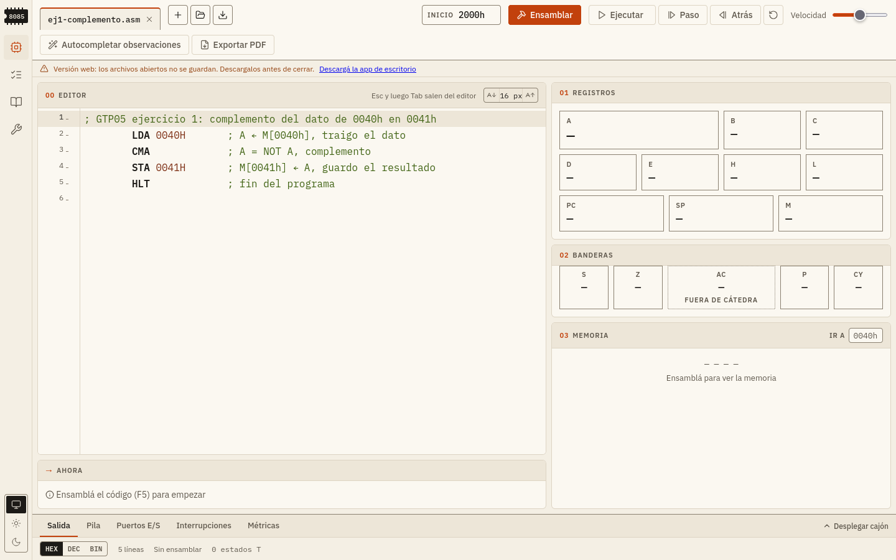
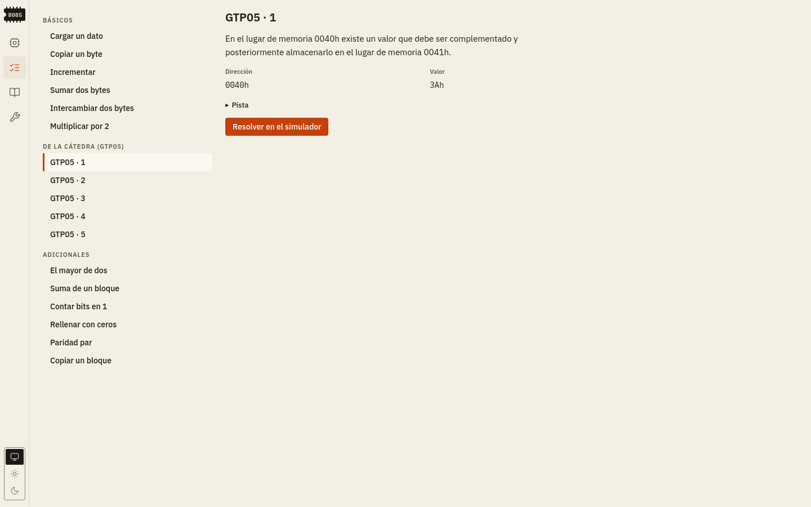
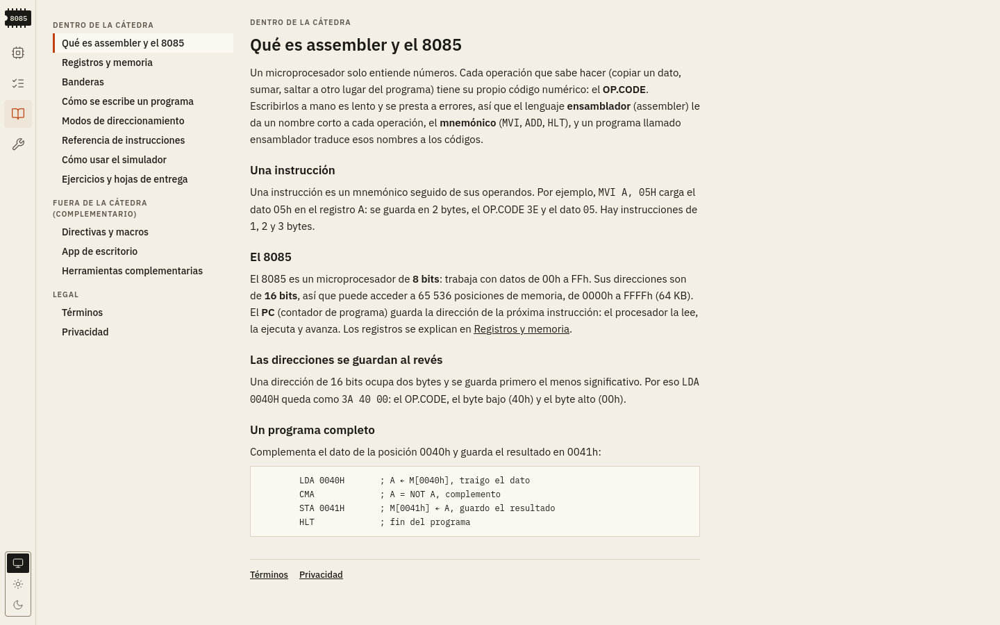

# Sim8085 · Simulador del Intel 8085 para Arquitectura de Computadoras

Simulador educativo del microprocesador **Intel 8085**, pensado para la cátedra de *Arquitectura de Computadoras* (UTN, Facultad Regional Villa María). El alumno escribe un programa en ensamblador, lo ejecuta instrucción por instrucción, ve qué cambia en los registros, las banderas y la memoria, y exporta la hoja de entrega en PDF con el formato de la cátedra.

Funciona **en el navegador, sin instalar nada**, y también como **aplicación de escritorio** para Linux y Windows. No hay cuentas, no hay servidor y no se envía ningún dato: todo corre en la computadora del alumno.



## Qué resuelve

| Para el alumno | Para la cátedra |
| --- | --- |
| Ver qué hace cada instrucción, en lenguaje simple, mientras ejecuta paso a paso (y hacia atrás). | Usa la **misma terminología y el mismo Set de Instrucciones** que el manual de la cátedra. Lo que no figura ahí se marca como «fuera de la cátedra». |
| Errores del ensamblador en español, subrayados mientras escribe. | La hoja de entrega sale en PDF con el **encabezado y las columnas de la plantilla oficial** (Dirección / Mnemónico / OP.CODE / Observación). |
| Practicar con ejercicios que se corrigen solos. | Incluye los ejercicios del GTP05 de la cátedra, más básicos y adicionales (17 en total). |
| Consultar la documentación sin salir de la app. | No hay datos personales ni telemetría: se puede usar sin firmar ni aceptar nada. |

## Qué incluye

- **Editor** con pestañas, resaltado, autocompletado de instrucciones, ayuda al pasar el mouse y puntos de corte.
- **Ensamblador** completo: etiquetas, `ORG`, `EQU`, `DB`, `DW`, `DS`, macros y números en hexadecimal, binario y decimal.
- **Ejecución**: todo de una vez, paso a paso, **paso atrás**, velocidad regulable, y aviso ante posibles bucles infinitos.
- **Estado de la máquina**: registros A, B, C, D, E, H, L, pares, PC y SP; banderas S, Z, AC, P y CY; memoria de 64 KB editable; pila; puertos de entrada y salida; interrupciones (TRAP, RST 7.5, 6.5 y 5.5). Los valores cambian entre hexa, decimal y binario, y lo que se modificó en cada paso queda resaltado.
- **Métricas** del programa: bytes, instrucciones ejecutadas y estados T.
- **PDF de entrega** del código ensamblado o de la traza de ejecución, con opción de **autocompletar las observaciones** en lenguaje simple.
- **Ejercicios** con verificación automática y una **caja de herramientas** (conversor de bases, complemento a 2).
- **Documentación** integrada: qué es el 8085, registros, banderas, direccionamiento, referencia de todas las instrucciones, directivas y macros.





## Cómo usarlo

**En la web:** abrir el sitio del simulador. No requiere instalación. En el celular solo se puede leer la documentación; el simulador necesita una computadora.

**Aplicación de escritorio:** se descarga desde la sección *Documentación → Instalación* de la web, o directamente desde la [última versión](https://github.com/Facundo-Gauna/Sim8085-UTN-FRVM/releases/latest).

| Sistema | Archivo | Notas |
| --- | --- | --- |
| Windows | `…-setup.exe` o `….msi` | Instalador. Al no estar firmado, SmartScreen puede avisar: «Más información» → «Ejecutar de todos modos». |
| Windows | `…-portable.zip` | No se instala: se descomprime y se abre `Sim8085.exe`. Útil en laboratorios sin permisos de administrador. |
| Linux | `.AppImage`, `.deb`, `.rpm` | El AppImage no se instala, solo se marca como ejecutable. |

La versión de escritorio agrega un **panel de archivos**: se abre una carpeta del equipo, se guardan los programas como `.asm` y los PDF se guardan en esa misma carpeta.

## Para los docentes

- El **Set de Instrucciones** y los nombres de registros, banderas y modos de direccionamiento siguen el manual de la cátedra.
- La documentación de instrucciones se genera desde la misma tabla que usa el simulador, así que lo que se explica es lo que se ejecuta.
- El simulador **no detecta** si las observaciones del PDF las escribió el alumno o las generó el autocompletado.
- Está **pendiente de confirmar con la cátedra** la consigna del ejercicio 4 del trabajo práctico 5 (se interpretó como «nibble alto», `B7h → B0h`).
- Cualquier diferencia entre el simulador y el manual se considera un error del simulador: se puede reportar en [Issues](https://github.com/Facundo-Gauna/Sim8085-UTN-FRVM/issues).

## Para desarrollar

Monorepo con npm workspaces:

| Paquete | Qué contiene |
| --- | --- |
| `packages/core` | Ensamblador, CPU, máquina, trazas, métricas y ejercicios (TypeScript, sin dependencias de interfaz). |
| `packages/web` | Interfaz web (React, Zustand, CodeMirror 6, Vite). Genera los PDF con `pdf-lib`. |
| `packages/desktop` | Aplicación de escritorio (Tauri 2, Rust) y scripts de descargas. |

```bash
npm install
npm run dev -w @sim8085/web        # servidor de desarrollo en http://localhost:5173
npm test -w @sim8085/core          # pruebas del núcleo
npm test -w @sim8085/web           # pruebas de la web
npm run build -w @sim8085/desktop  # instaladores del sistema actual (requiere Rust)
```

Las especificaciones y los planes de implementación están en `docs/superpowers/`. Para publicar una versión se crea un tag `vX.Y.Z`: GitHub Actions compila Linux y Windows y publica los instaladores en un release.

## Licencia

[MIT](LICENSE) © 2026 Facundo Gauna.
